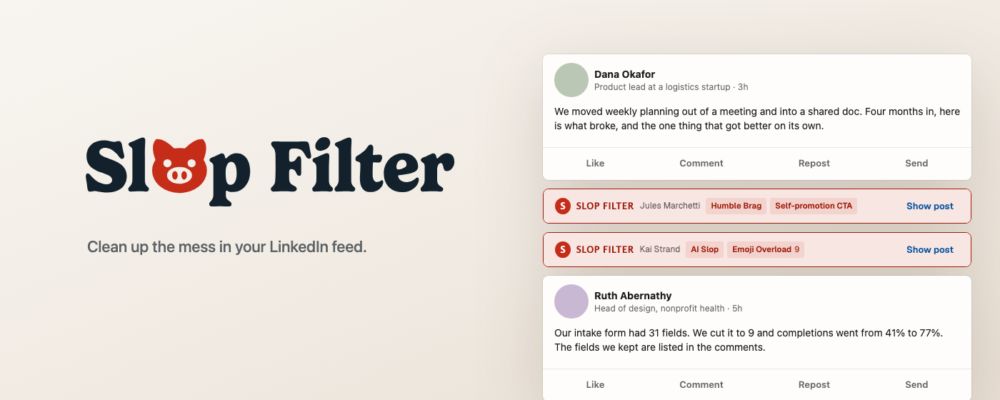
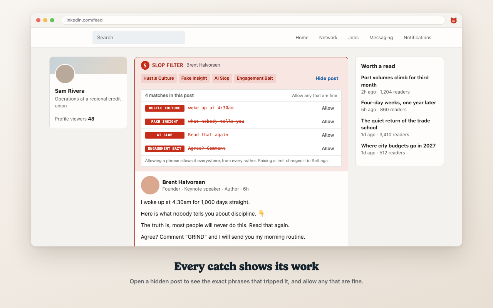
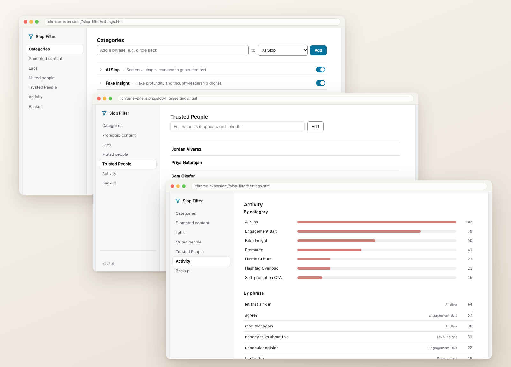

# Slop Filter for LinkedIn

A Chrome extension that fixes one of the biggest problems in the corporate world today. It cleans up LinkedIn the way LinkedIn's own developers should be filtering it, and makes it the powerhouse social network it was meant to be. Some would say it's the most important Chrome extension in the world.

I was talking to a former colleague who said one of the saddest things I've ever heard: "LinkedIn is my favorite social network." With this extension, maybe we can get it back there.

(To be clear, LinkedIn should not be your favorite social network.)

Not affiliated with LinkedIn.

## The Insight

AI delivers digital slop because it was trained on human slop.

Every "let that sink in" a chatbot writes today, it learned from a person who wrote it first. LinkedIn spent a decade teaching people to post like this, and then the models read all of it. Slop Filter catches the phrase, whoever typed it.

## Here's how it works

- **Say goodbye to noise.** All the AI and human slop disappears, and what you want to see comes back into the feed.
- **On-device analysis.** Every post is read right in your browser, and each flagged one shows the exact phrase that caught it.
- **Ultimate personalization.** Edit any phrase, build your own categories, and choose whose posts always come through.
- **Resurface what's valuable.** With the slop out of the way, real updates from the people you know stand out again.
- **Nothing leaves your browser.** No account, no tracking, no AI, no server.

The filter reads every post as your feed loads and pulls out the slop before you have to wade through it. What's left is the reason you joined LinkedIn in the first place. The people you know and the work they're proud of. Install it once and your feed stays clean for good. (Yep, you can even get rid of all those long emoji posts.)

## Install

Slop Filter is being approved by the Chrome Web Store. Until it's live:

1. Download this repo as a ZIP and unzip it, or clone it.
2. Go to `chrome://extensions` and turn on **Developer mode**, top right.
3. Click **Load unpacked** and pick the folder.
4. Reload LinkedIn.

## What it catches

You know these posts. You've scrolled past thousands of them. You've liked a few out of guilt. Slop Filter sorts them into nine piles:

- **AI Slop**: "let that sink in"
- **Fake Insight**: "nobody talks about this"
- **Engagement Bait**: "agree?"
- **Hustle Culture**: "5am club"
- **Self-promotion CTA**: "follow me for more"
- **Sponsored**: #ad
- **Hashtag Overload**: five or more
- **Emoji Overload** (off to start): five or more
- **Humble Brag** (off to start): "humbled to announce"

Humble Brag starts off because "excited to announce" is also how people share a new job or a new kid.

Every list is yours to edit. Add phrases, cut the ones that bug you, or build a category of your own. And because everyone has a friend who posts like a LinkedIn growth coach, there's **Trusted People**: add someone by name and their posts always come through untouched, slop and all. You can love a person and still hate their content strategy.

## Make it yours

## Private by design

Nothing leaves your browser. No account, no analytics, no server, no network requests. Your settings live in Chrome's own extension storage.

It asks Chrome for two permissions: `storage`, to remember your settings, and access to linkedin.com, to read the feed. That's the full list.

## Why I built this

I'm Matt DeSiena, and I've spent the better part of twenty years in social media at some of the best-known agencies in the Big 3 holding companies. Everywhere I go, from Cannes Lions 2026 to a long list of ad conferences, I hear the same thing. LinkedIn is the bane of every user's existence.

At Cannes I spent time outside Microsoft's exhibits. Microsoft owns LinkedIn, and even there, people were talking about how they just don't want to be on it.

Slop Filter is built to change that. It turns LinkedIn from the site people shudder at opening into one they actually look forward to.
